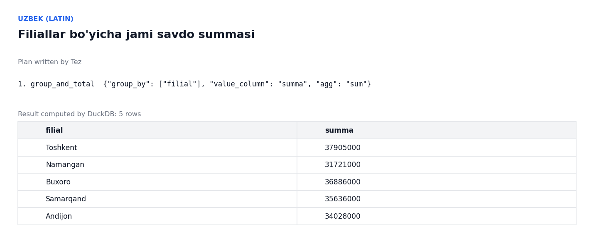
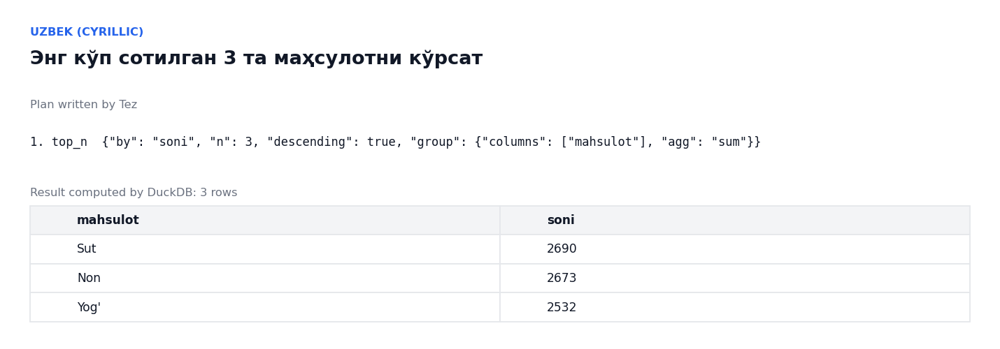
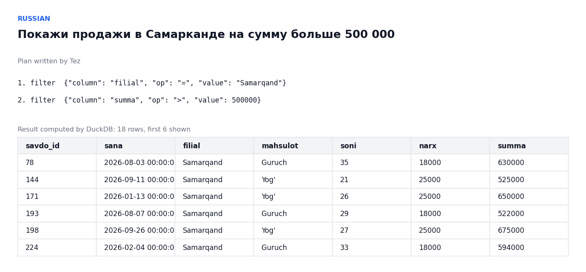
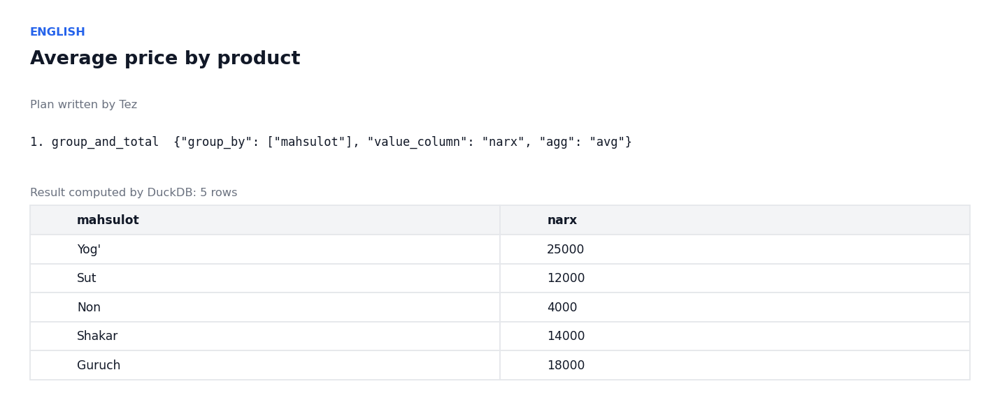
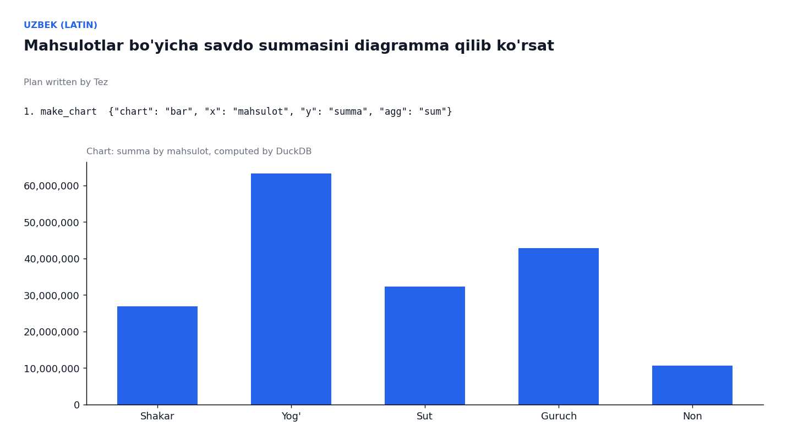
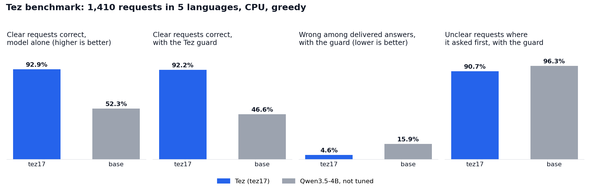
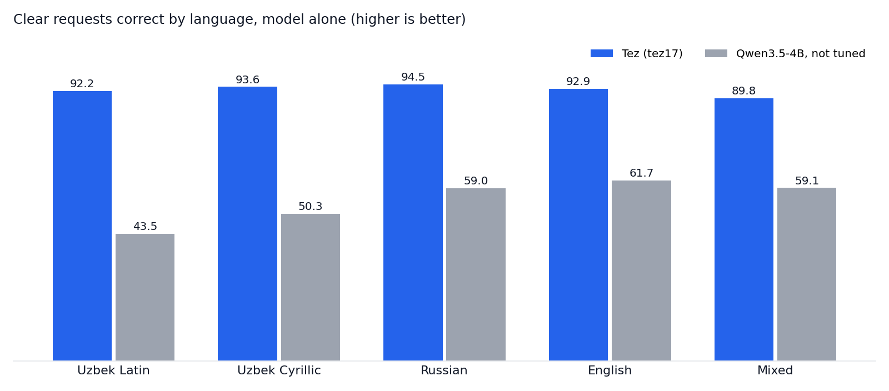
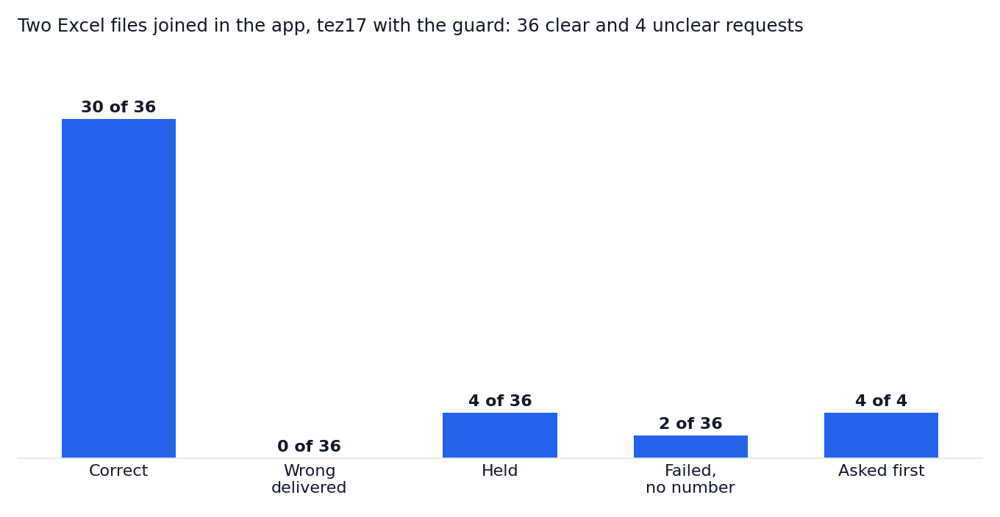

# Tez: a small offline model for questions about Excel and CSV tables

Tez turns a request about a table into a short plan of tool calls, or asks one clarifying question when the request is not clear. It reads Uzbek (Latin and Cyrillic), Russian, English and mixed requests.

The model never computes numbers. It only writes the plan. In the Tez app, both the model (through llama.cpp) and the plan (in DuckDB) run on the user's own computer, and by default the model server listens only on that computer (127.0.0.1). No network test has been published yet, so this page makes no measured claim that nothing leaves the computer.

[](https://colab.research.google.com/github/Abulqosim0227/Tez-Qwen3.5-4B/blob/main/tez_colab.ipynb)

**Model file:** [huggingface.co/Abulqosim0227/Tez-Qwen3.5-4B-GGUF](https://huggingface.co/Abulqosim0227/Tez-Qwen3.5-4B-GGUF). This repository has the code, the notebook and the pictures. The 2.7 GB model file is on Hugging Face.

This is a fine-tune of [Qwen/Qwen3.5-4B](https://huggingface.co/Qwen/Qwen3.5-4B), quantized to Q4_K_M (2.71 GB). It runs on a CPU.

## See it working

These pictures come from real runs of this model on a made-up sales table of 600 rows (5 branches, 5 products, 2026), on a CPU, on 2026-11-24. Each shows the request, the plan the model wrote, and the result DuckDB computed. The Colab notebook builds the same table, so you can repeat them.

**Uzbek (Latin): "total sales by branch". One grouped sum.**



**Uzbek (Cyrillic): "show the 3 best-selling products". The model chose to rank products by the total number sold.**



**Russian: "show sales in Samarkand over 500,000". Two filters; the model wrote the value as it is stored in the table (Samarqand).**



**English: "average price by product".**



**Uzbek (Latin): "show sales by product as a chart". A bar chart.**



**Uzbek (Latin): "analyse it". The request names no action, so Tez asks a question instead of guessing.**


The requests, plans and row counts are also in `images/examples/examples.json`.

## Answer format

Two of the example answers shown to the model in its prompt for the sample loans table (`examples/bank_loans/examples.json`):

Request: `Kredit xodimlari bo'yicha qoldiqlar yig'indisi` ("sum of balances by loan officer").

```json
{"steps": [{"tool": "group_and_total", "args": {"group_by": ["kredit_xodimi"], "value_column": "qoldiq_uzs", "agg": "sum"}}]}
```

Request: `Tahlil qil` ("analyse it").

```json
{"ask": "Qanday tahlil kerak: qaysi ko'rsatkich (qoldiq, kredit summasi, kechikish) va qaysi kesimda (filial, kredit turi, oy)?"}
```

The 18 tools: `filter`, `remove_rows`, `filter_dates`, `group_and_total`, `period_compare`, `top_n`, `fix_dates`, `fix_numbers`, `unify_spelling`, `remove_duplicates`, `fill_empty`, `make_chart`, `sort`, `select_columns`, `export_xlsx`, `export_html`, `add_computed_column`, `add_value_column`. A plan has at most 4 steps. Their arguments are in `prompt/tools.json`.

## Intended use

Use it to turn a worker's request about one table into a plan that software runs and a person can check. It is not a general chat model, and it does not know anything about your data except the table description it is given. Check results before using them for decisions.

## Requirements

- Model file: 2.71 GB. RAM measured with the server running: about 5.4 GB.
- A CPU is enough. No GPU is needed.
- Python 3 for `example.py`, with no extra packages.

## Try it on Colab

Click the **Open in Colab** button above. The notebook explains each step and:

1. installs llama.cpp b11946 and downloads the model (CPU runtime is enough);
2. runs requests in four languages on a small demo sales table and shows the plans and result tables, a chart and an Excel export;
3. lets you upload your own CSV or Excel file and ask about it.

The notebook's code was run end to end with this model on 2026-11-24, outside Colab. The Colab-only steps (the downloads and the file upload) have not yet been run inside Colab.

## How to run it

The model needs its exact prompt and output grammar. Both are in this repository.

1. Download the model:

```bash
pip install huggingface_hub
hf download Abulqosim0227/Tez-Qwen3.5-4B-GGUF Tez-tez17-agent-Q4_K_M.gguf --local-dir .
```

2. Start [llama.cpp](https://github.com/ggml-org/llama.cpp) (the benchmark used build b11946):

```bash
llama-server -m Tez-tez17-agent-Q4_K_M.gguf --jinja -c 8192 --host 127.0.0.1 --port 8080
```

3. Ask for a plan on the sample table:

```bash
python example.py "Kredit turlari bo'yicha qoldiq yig'indisi"
```

`example.py` uses only the Python standard library. It builds the system prompt and the JSON schema with `prompt/build.py`, turns thinking off, and uses temperature 0 with at most 200 output tokens.

It sends the table description (column names, sample and listed values) and the request to the server given by `--server`. Keep that server on your own computer.

For your own table, make a folder like `examples/bank_loans` with three files:

- `table.json`: the table name, row count, and each column's name, type, and sample or listed values;
- `glossary.json`: business words;
- `examples.json`: two or three example requests and answers.

For columns with listed values, the grammar allows only those values in a plan.

To run plans on data, the repository also has the Tez plan runner (`accuracy/tools.py`, the same DuckDB tools the app and the benchmark use) and the table describer (`training/make_table.py`, with its settings in `training/describe.json`). The notebook shows how to use them together. The result checks, the confidence gate and the app's confirmations before value-changing steps are not included.

## Results

### Internal development benchmark

The benchmark has 1,410 requests on 63 request sets:

- 1,248 clear requests and 162 that should get a question;
- languages: Uzbek Latin 565, Russian 315, English 270, Uzbek Cyrillic 168, mixed 92.

This is an internal development set, not an independent test.

- **Who wrote it:** the requests were written and reviewed by the project's AI agents (Claude and GPT), with the rules approved by the developer.
- **Seen during development:** it was used while the prompt and tools were developed with fine-tuned models in the loop.
- **Follow-up requests:** they receive the benchmark's reference history, not the model's own earlier answers.
- **No study with real users** exists yet.

Run settings: llama.cpp b11946 on a CPU, grammar on, thinking off, greedy decoding. A plan counts as correct when DuckDB gives the same result table as the reference plan.



- **Clear requests correct.**
  - Model alone: tez17 92.9% (1,159 of 1,248), untuned Qwen3.5-4B 52.3% (653).
  - With the Tez guard (confidence gate and result checks): 92.2% and 46.6%.
- **Wrong among delivered answers, with the guard:** 4.6% (55 of 1,206) against 15.9% (110 of 692).
- **Held or asked on clear requests, with the guard:** 42 of 1,248 for tez17 and 553 of 1,248 for the untuned model.
  - The untuned model therefore also scores higher on unclear requests that were not answered (96.3% against 90.7% of 162).
  - "Not answered" includes holds by the result checks, not only a clarifying question written by the model.



The largest gain is in Uzbek Latin, from 43.5% to 92.2%.

### Retail stress test: a weak result

There were 200 requests (176 new, 24 follow-ups) on one public retail table of 541,909 rows. They were written by an AI agent after it had seen earlier retail examples. They ran on the installed Tez 0.3.6 app with this same tez17 model.

The results under a separate rubric:

- 37 fully right;
- 74 wrong results delivered without a question;
- 5 follow-ups right on a wrong earlier step;
- 45 held although the tools could do it;
- 14 held where one plan cannot do it;
- 15 good abstentions;
- 7 failed;
- 1 wrong plan blocked;
- 1 choice offered;
- 1 guess.

Common wrong shapes:
- unit price summed as money instead of quantity times price;
- grouping by full timestamp when a day or month was asked;
- counting rows when distinct values were asked.

The workload and rubric differ, so this is not comparable with the percentages above. It shows that the benchmark result does not carry over to this table.

### Two files joined in the app



Each of two public tables was split into two Excel files with different column names, and the Tez app joined them back. The model then got 40 new requests written by an AI agent after the join: 36 clear and 4 unclear.

With the guard:
- 30 clear requests were correct and 0 wrong answers were delivered (0 of 30 delivered).
- 4 were held:
  - one by the confidence gate;
  - three by result checks ("grouping changed nothing", "empty result", "filter kept every row").
- 2 failed with an error and showed no number:
  - "regions where loans exceed deposits" needs a computed difference and then a filter, because no tool compares one column with another;
  - "ratio of loans to deposits" was a bad plan, although one ratio step was enough.
- All 4 unclear requests got a question.

Average time was 5.3 s per request on a desktop CPU (i9-14900K).

This set is small. With 0 wrong in 30 delivered answers, the 95% interval for the wrong-delivered rate still reaches 11.4%.

All three pictures are drawn from the saved scored rows. Their numbers are in `images/results.json`.

## Limits

- **The comparison with the untuned model:**
  - The untuned model ran from a different quantization (with an importance matrix), and its effect was not isolated.
  - The two GGUF files carry different chat templates.
  - Each model ran once.
- **Shared tables:** two synthetic tables, bank transactions and retail sales, appear in training and in 133 of the 1,410 benchmark requests (with different request texts).
  - Without those 133 requests, clear requests correct for the model alone is 92.7% for tez17 against 50.1% for the untuned model.
  - The search was by table name.
- **Repeated texts:** 29 training rows have the same text as 8 benchmark requests (tez17 answers all 8 right).
- **Comparing two columns is weak.**
- **One table at a time:** joins are done by the app before the model sees the table.
- **`example.py` smoke test:** tested on 2026-11-24 with this file on a CPU, with three requests on the sample table (Uzbek, Russian and a vague one). It gave a grouped sum, a filter and a clarifying question. That is a smoke test, not an evaluation. The first request took 33 s while the prompt was read; the next ones took 3 to 4 s.

## Training

- **Method:** QLoRA (r 16, alpha 32), 1 epoch, learning rate 2e-4, on one RTX 5070 Ti.
- **Data:** 38,258 rows on synthetic tables with made-up values.
- **How the rows were made:** code generated the plans and ran them in DuckDB, and a local Gemma 4 E4B model wrote the request texts. No cloud model wrote training data, and no real customer data was used.
- **Loss:** training 0.0577, validation 0.0401.

## Licence

Apache 2.0, the same as Qwen3.5-4B. This model is a modified version of Qwen3.5-4B by the Qwen team.

## More

The full development story (in Uzbek), including every model version, test and mistake: https://pysphere.uz/kitob/tez/
